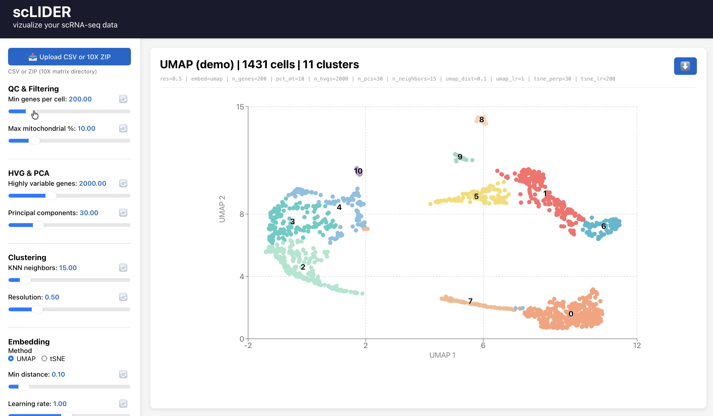

# scLIDER

**A powerful, interactive web-based tool for single-cell RNA-seq (scRNA-seq) analysis**

Visualize, analyze, and explore your single-cell transcriptomics data with an intuitive interface. Process raw sequencing data through quality control, normalization, and clustering pipelines, then interactively explore the results with configurable dimensionality reduction and embedding techniques.



## 🎯 Features

- **📊 Interactive Visualization**: Real-time UMAP/t-SNE plots with cluster highlighting and point tooltips
- **🔧 Quality Control & Filtering**: Automatically filter cells and genes based on QC metrics
  - Minimum genes per cell threshold
  - Maximum mitochondrial percentage filter
- **📈 Normalization & Feature Selection**: 
  - Log normalization of gene expression data
  - Highly variable gene selection
- **🎨 Dimensionality Reduction**: 
  - Principal Component Analysis (PCA) for initial dimensionality reduction
  - UMAP embedding with configurable parameters
  - t-SNE embedding with adjustable perplexity
- **🔗 Graph-based Clustering**: Leiden clustering with configurable resolution
- **📥 Multiple Data Formats**: Support for 10X Genomics and CSV formats
- **💾 Easy Export**: Download plots and processed data
- **⚡ Demo Dataset**: Built-in demo dataset for quick exploration


## Project Structure

```
scLIDER/
├── api/                          # FastAPI backend
│   └── main.py                   # API endpoints for data upload and analysis
├── scrna_pipeline/               # Analysis pipeline
│   ├── pipeline.py               # Core scRNA-seq processing logic
│   └── cli.py                    # Command-line interface
├── frontend/                     # React/Vite web interface
│   ├── src/                      # React components and pages
│   ├── package.json              # Frontend dependencies
│   └── vite.config.js            # Vite configuration
├── data/                         # Sample data directory
└── requirements.txt              # Python dependencies
```

## Tech Stack

**Backend:**
- Python 3.9+
- FastAPI for REST API
- Scanpy for scRNA-seq analysis
- AnnData for data structures
- Leiden for graph-based clustering

**Frontend:**
- React 18
- Vite build tool
- Recharts for visualization

## 💻 System Requirements

### Minimum Requirements
- **Python**: 3.9 or higher
- **Node.js**: 16 or higher
- **RAM**: 8 GB (16 GB recommended for large datasets)
- **Disk Space**: 2 GB for dependencies
- **OS**: Windows, macOS, or Linux

### Python Dependencies (Backend)
- scanpy (single-cell analysis)
- pandas, numpy, scipy (data processing)
- umap-learn, scikit-learn (dimensionality reduction)
- leidenalg (clustering)
- fastapi, uvicorn (API server)

### JavaScript Dependencies (Frontend)
- React 18
- Vite (build tool)
- Recharts (visualization)

## Installation

### Backend Setup

1. Clone the repository:
```bash
git clone <repository-url>
cd scLIDER
```

2. Create a Python virtual environment:
```bash
python -m venv venv
source venv/bin/activate  # On Windows: venv\Scripts\activate
```

3. Install Python dependencies:
```bash
pip install -r requirements.txt
```

### Frontend Setup

1. Navigate to the frontend directory:
```bash
cd frontend
```

2. Install Node.js dependencies:
```bash
npm install
```

## 🚀 Getting Started

### Quick Start (Development)

#### Terminal 1: Start the Backend API
```bash
cd /path/to/scLIDER
source venv/bin/activate  # or on Windows: venv\Scripts\activate
uvicorn api.main:app --reload
```
The API will be available at `http://localhost:8000` with interactive API docs at `http://localhost:8000/docs`

#### Terminal 2: Start the Frontend
```bash
cd /path/to/scLIDER/frontend
npm run dev
```
Open your browser to `http://localhost:5173`

### Complete Workflow

#### 1. **Load Data**
   - Click "Upload CSV" to select your data, OR
   - Click "Load Demo" to use the built-in demo dataset
   - Supported formats:
     - **CSV**: Gene expression matrix with genes as rows, cells as columns
     - **10X Genomics**: Zipped directory containing matrix.mtx, features.tsv, barcodes.tsv

#### 2. **Configure Analysis Parameters**
   Use the sliders in the left sidebar to adjust:
   
   | Parameter | Range | Default | Purpose |
   |-----------|-------|---------|---------|
   | Min Genes | 0-1000 | 200 | Minimum genes per cell (QC filter) |
   | Max MT % | 0-100 | 10 | Maximum mitochondrial % (QC filter) |
   | HVG Count | 1000-5000 | 2000 | Highly variable genes to select |
   | PCA Dims | 10-100 | 30 | Principal components |
   | K Neighbors | 5-30 | 15 | KNN graph parameter |
   | Clustering Res | 0.1-2.0 | 0.5 | Leiden resolution (higher = more clusters) |
   | Embedding | UMAP/t-SNE | UMAP | Dimensionality reduction method |

#### 3. **Run Analysis**
   - Click the green **"▶ Run Pipeline"** button
   - Watch the status indicator as the analysis runs
   - Analysis includes:
     - Quality control filtering
     - Log normalization
     - Highly variable gene selection
     - PCA computation
     - KNN graph construction
     - Leiden clustering
     - UMAP or t-SNE embedding

#### 4. **Explore Results**
   - View the interactive scatter plot showing all cells
   - Cells are colored by cluster assignment
   - Hover over points to see cell information
   - Zoom and pan to explore specific regions
   - Click **"📥 Download"** to save the visualization as PNG

## 📚 References

- **Scanpy Documentation**: https://scanpy.readthedocs.io/
- **UMAP**: https://umap-learn.readthedocs.io/
- **t-SNE**: https://github.com/scikit-learn/scikit-learn
- **Leiden Clustering**: https://github.com/vtraag/leidenalg